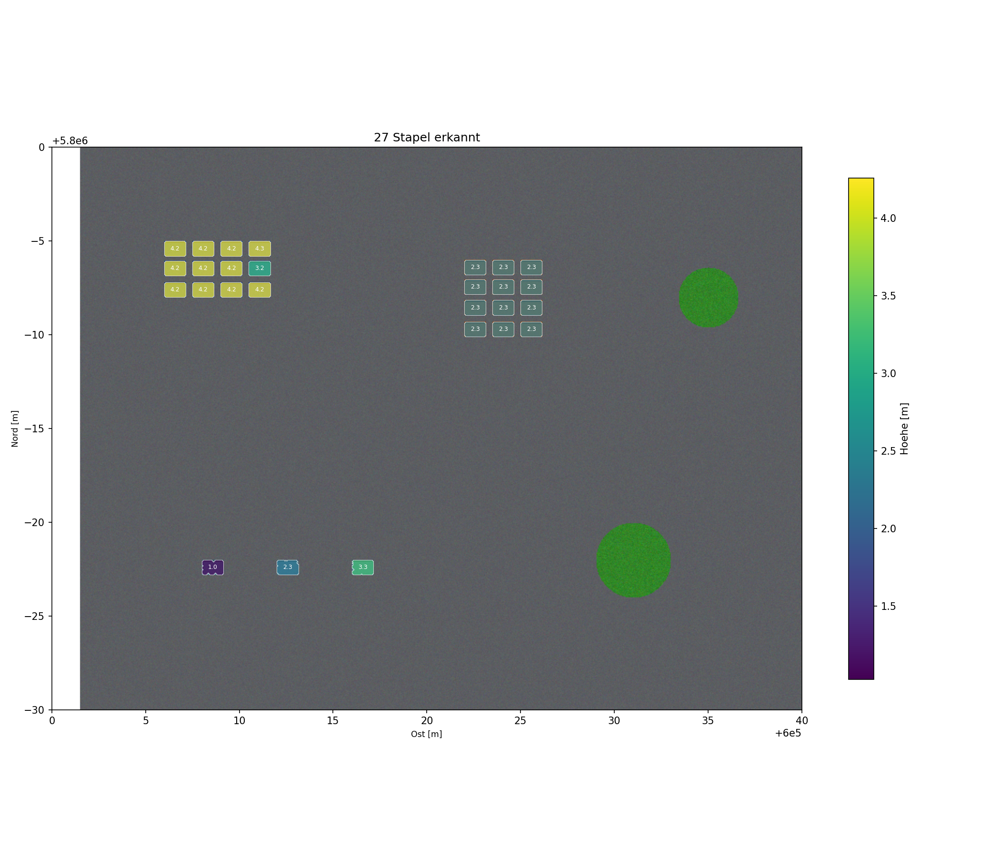
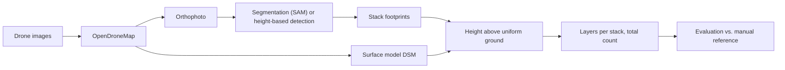

# Drone-based Container Inventory

Counting empty returnable containers on a factory yard from drone images. A top-down view only shows the **top** container of every stack, so this project combines two data streams from the same photogrammetric reconstruction:

- the **orthophoto** separates the stacks (segmentation, one footprint per stack),
- the **surface model (DSM)** resolves the stacking (height above ground ÷ container height = number of layers).

Neither stream is enough alone: segmentation cannot see stack height, and height cannot separate neighbouring stacks. Together they give a complete inventory.

This repository is the code of my bachelor thesis *"Drohnengestützte Behälterinventur mittels KI-basierter Segmentierung und Photogrammetrie"* (Ostfalia University of Applied Sciences, Digital Engineering, 2026), restructured into an installable package with a CLI, tests and a synthetic demo that runs without any real data.



## Quickstart (no data needed)

```bash
git clone https://github.com/USERNAME/drone-container-inventory.git
cd drone-container-inventory
python -m venv .venv && source .venv/bin/activate     # Windows: .venv\Scripts\activate
pip install -e .
containerinv demo
```

The demo builds a synthetic yard (27 stacks in three blocks plus two trees), runs detection, height measurement, layer counting and evaluation, and writes everything to `demo/out/` (overview image, GeoJSON, `evaluation.json`). `pytest` runs the test suite (16 tests, ~5 s). A `Dockerfile` and `environment.yml` are included for headless and conda setups.

> The synthetic scene proves that the logic works. It is **not** a performance claim, see the real results below.

## Results from the thesis (real factory flight)

Validation on one real flight over a returnable-container yard (DJI Mini 2, 30 m altitude, 152 images, about 7,800 m², OpenDroneMap 3.5.4).

| Requirement | Result | Status |
|---|---|---|
| Counting accuracy ≥ 95 % (NFA-01) | 80 detected vs. 79 real footprints: **98.7 %**; recall 100 %, precision 98.8 %, F1 99.4 % | met (closed containers) |
| Position accuracy ≤ 0.5 m (NFA-02) | 0.73 m RMS with onboard GNSS only (no ground control points); relative model accuracy 0.08 m | **not met**, fixable with ground control points |
| Ground resolution ≤ 2 cm (NFA-03) | 1.0 cm per pixel | met |
| Capture time ≤ 30 min (NFA-04) | about 15 min on site (8 min flight) | met |
| Total quantity | 316 estimated vs. 313 counted by hand (≈ 99 %) | see caveat |

**Honest limits** (all discussed in the thesis):

- The nominal container height of 1.5 m was **back-calculated** from the median stack height (6 m at four layers), not taken from master data. The quantity result is therefore internally consistent, but not an independent proof of the height-to-layers step.
- Open, see-through **mesh containers** are the main limit: photogrammetry produces hardly any height over them, and the model merges the uniform mesh into one region.
- Very dense stacks without a visible joint are hard to separate from above.
- One flight, one yard: the numbers show feasibility, not operational readiness.

## Pipeline



Two routes produce the footprints:

| Route | Command | Notes |
|---|---|---|
| **A. Image-based (validated in the thesis)** | `segment` (automatic SAM) or `pick` + `segment --points` (one click per stack) | needs `pip install -e ".[sam]"`; separates dense, uniform blocks reliably |
| **B. Height-based baseline** | `detect` | no model, nDSM + greenness filter + watershed; merges blocks of equal height and misses mesh containers, which is exactly why the thesis uses route A for detection and the height only for stacking |

## Full workflow with real data

1. **Reconstruct** with OpenDroneMap (pinned image for reproducibility):
   ```bash
   docker run -ti --rm -v "$PWD/project:/datasets/code" opendronemap/odm:3.5.4 \
     --project-path /datasets --dsm --orthophoto-resolution 2 \
     --pc-quality low --texturing-single-material --max-concurrency 2 --rerun-all
   ```
   Put the result in `data/` (the expected layout is ODM's `odm_orthophoto/` and `odm_dem/`), or point to files with `--ortho` / `--dsm`.
2. *(optional)* **Crop** a region to keep SAM runtime low: `containerinv --project data crop` (GUI).
3. **Footprints:** `containerinv segment` (or `pick`, then `segment --points`), or `detect` for route B.
4. **Heights:** `containerinv heights` (uniform ground level from the free area).
5. **Quantity:** `containerinv estimate --nominal-height 1.5`.
6. **Figure:** `containerinv visualize`.
7. **Evaluate** against a manual reference (GeoJSON points, optional attributes `klasse`, `lagen`): `containerinv evaluate --reference data/referenz.geojson --nominal-height 1.5`.

`containerinv run` chains detect, heights, estimate, visualize and (if a reference exists) evaluate. All parameters live in [`src/containerinv/config.py`](src/containerinv/config.py).

## Repository layout

```
src/containerinv/
  cli.py            command line
  config.py         paths and all parameters
  tiling.py         overlapping tiles for annotation
  segment.py        SAM, automatic mode, filters, de-duplication
  segment_points.py SAM, one mask per clicked point
  detect.py         height-based detection (route B)
  heights.py        height above a uniform ground level
  stack_count.py    layers per stack with a local ground ring
  estimate.py       total number of containers
  evaluate.py       precision / recall / F1 / count accuracy
  visualize.py      overview figure
  synthetic.py      synthetic scene for demo and tests
  tools/            GUI helpers: crop, pick points, sample window
tests/              pytest, runs on synthetic data
docs/               thesis summary (German), workflow, changes
```

## Documentation

- [`docs/thesis-summary.md`](docs/thesis-summary.md): summary of method, results and limits (German)
- [`docs/changes.md`](docs/changes.md): what changed compared with the thesis code

## Data and license

No raw images, orthophotos or the thesis PDF are included. License: *to be added.*
